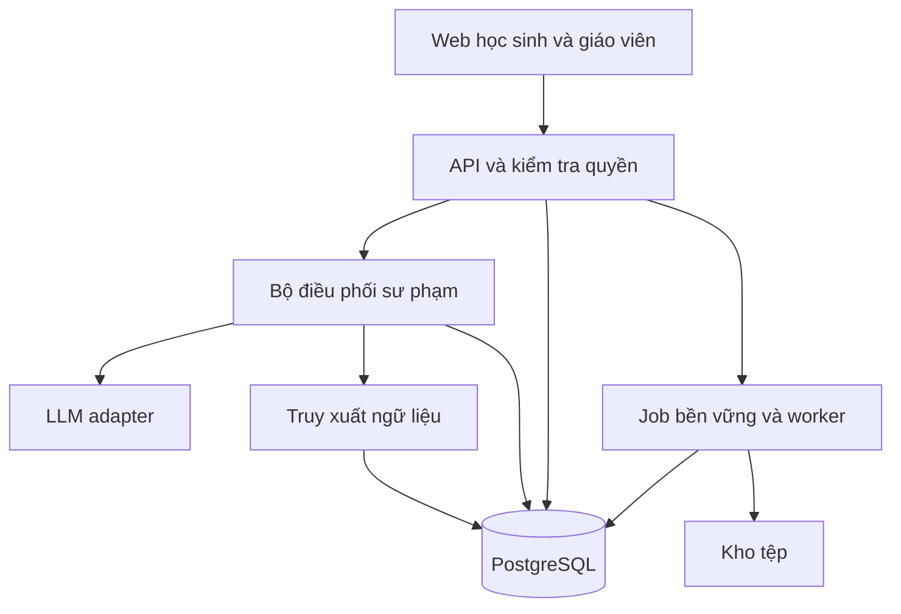

# Tài liệu kỹ thuật triển khai gia sư AI Socratic trong môn Ngữ văn

Phiên bản 1.0 | Ngày 16 tháng 10 năm 2026

Tài liệu phục vụ nhóm phát triển phần mềm, giáo viên Ngữ văn và nhóm nghiên cứu khoa học. Hệ thống hướng dẫn học sinh tự xác định cách làm, xây dựng lập luận và phản biện thông qua đối thoại có định hướng. Phạm vi đầu tiên là đọc hiểu và nghị luận xã hội ở một khối THPT; mở rộng nghị luận văn học sau khi có ngữ liệu và rubric được giáo viên kiểm duyệt.

Thiết kế lựa chọn một bộ điều phối sư phạm có trạng thái, kết hợp LLM với quy tắc được thực thi bằng code. Điểm đánh giá phải truy được về bằng chứng của học sinh. Hiệu quả học tập được kiểm chứng bằng bài làm độc lập với AI, tách khỏi điểm do hệ thống tự chấm trong phiên học.

## 1 Mục tiêu và phạm vi đề tài

### 1.1 Mục tiêu nghiên cứu

RQ1: Gia sư có lựa chọn câu hỏi và mức hỗ trợ phù hợp với khó khăn học sinh thể hiện trong môn Ngữ văn không?

RQ2: Học sinh sử dụng gia sư Socratic có cải thiện chất lượng lập luận và phản biện trên bài làm không có AI hỗ trợ so với chatbot trả lời trực tiếp không?

RQ3: Đánh giá theo rubric của AI thống nhất đến mức nào với giáo viên, và sai lệch thường xuất hiện ở tiêu chí nào?

H1: Nhóm sử dụng gia sư Socratic có điểm lập luận trên bài làm độc lập sau can thiệp cao hơn nhóm chatbot trả lời trực tiếp, sau khi điều chỉnh mức đầu vào. H2: Tỷ lệ quyết định sư phạm được giáo viên chấp nhận đạt ngưỡng nghiệm thu đã xác lập trước. Đây là các giả thuyết cần kiểm chứng, chưa phải kết luận về hiệu quả của hệ thống.

### 1.2 Phạm vi phiên bản đầu tiên

| Hạng mục | Phạm vi triển khai |
| --- | --- |
| Đối tượng | Một khối THPT được giáo viên chọn trước khi xây bộ đề |
| Dạng bài | Đọc hiểu và nghị luận xã hội; câu trả lời ngắn, dàn ý, đoạn văn |
| Ngữ liệu | Do người dùng tải lên hoặc do giáo viên cung cấp và kiểm duyệt |
| Tệp | Văn bản nhập trực tiếp, DOCX và PDF có chữ; OCR là bước mở rộng |
| Phương pháp | Sáu nhóm câu hỏi Socratic và năm mức hỗ trợ |
| Đánh giá | Rubric có bằng chứng; điểm chất lượng và mức tự lực được lưu riêng |
| Quản lý | Tài khoản, lớp, phiên học, hiệu chỉnh của giáo viên, xuất dữ liệu nghiên cứu |

Giới hạn phiên bản đầu: chưa huấn luyện LLM riêng; chưa phát triển đa môn; chưa tự động đưa ra kết luận ổn định về năng lực cá nhân từ một phiên. Hệ thống dùng một nhà cung cấp LLM qua lớp adapter để có thể thay mô hình mà không đổi nghiệp vụ.

### 1.3 Sản phẩm bàn giao và giả định

Sản phẩm gồm ứng dụng web, backend API, cơ sở dữ liệu và migration, cấu hình triển khai, bộ đề và rubric có phiên bản, bộ kiểm thử, báo cáo thực nghiệm và hướng dẫn vận hành. Kế hoạch nguồn lực giả định hai người phát triển và một giáo viên Ngữ văn bán thời gian. Khối lớp, nơi thử nghiệm, cỡ mẫu, ngân sách và nhà cung cấp mô hình là các quyết định cần chốt ở giai đoạn khởi động.

Các ngưỡng hiệu năng, kích thước tệp và tiêu chí chất lượng trong tài liệu là mục tiêu thiết kế ban đầu. Nhóm phải đo trên môi trường thử và phê duyệt lại trước khi mở rộng sử dụng.

## 2 Cơ sở sư phạm và mô hình hoạt động

### 2.1 Phân biệt ba thành phần

Socratic định hướng cách đặt câu hỏi. Hỗ trợ thích ứng quyết định lượng hướng dẫn cần cung cấp. Bloom định hướng loại hoạt động nhận thức và bằng chứng cần quan sát. Bloom là khung phân loại mục tiêu nhận thức; công thức 30–35–35 trong đề tài là mô hình chấm điểm được đề xuất riêng, cần hiệu chuẩn [S1].

Không gắn cố định một nhóm Socratic với một mức Bloom. Câu hỏi về bằng chứng có thể chỉ yêu cầu nhớ chi tiết hoặc có thể yêu cầu đánh giá độ thuyết phục của chi tiết, tùy nội dung nhiệm vụ và câu trả lời thực tế.

### 2.2 Sáu nhóm câu hỏi sử dụng trong hệ thống

| Mã chiến lược | Mục đích | Ví dụ Ngữ văn |
| --- | --- | --- |
| clarification | Làm rõ khái niệm và phát biểu | Em dùng từ trách nhiệm theo nghĩa nào trong nhận định này? |
| assumptions | Kiểm tra điều đang được mặc định | Nhận định của em có giả định rằng ai cũng có cùng điều kiện không? |
| evidence | Kiểm tra lý do và dẫn chứng | Chi tiết nào trong đoạn trích hỗ trợ luận điểm này? |
| perspectives | Xem xét cách nhìn khác | Người có quan điểm khác sẽ phản biện ý này như thế nào? |
| consequences | Xem xét hệ quả | Nếu thực hiện giải pháp đó, điều gì có thể xảy ra tiếp theo? |
| metacognition | Xem lại câu hỏi và cách nghĩ | Câu hỏi này giúp em kiểm tra phần nào trong lập luận? |

Đây là hệ nhãn vận hành của dự án. Mỗi phản hồi có một chiến lược chính để kiểm tra; không yêu cầu dùng đủ sáu nhóm trong một phiên. Giáo viên xem xét câu hỏi theo tác dụng thực tế, không chỉ dựa vào nhãn do mô hình sinh.

### 2.3 Nguyên tắc đối thoại

Mỗi lượt tập trung một yêu cầu chính. AI nhận xét cụ thể điều học sinh vừa làm được rồi đặt bước tiếp theo. Nếu học sinh thiếu kiến thức nền, AI được giải thích ngắn và yêu cầu học sinh vận dụng. Ví dụ minh họa ưu tiên tình huống tương tự để tránh viết thay ngay bài đang học.

Gia sư chấp nhận nhiều cách diễn giải có căn cứ trong Ngữ văn. Phản biện một quan điểm không đồng nghĩa đánh dấu sai; mô hình phải kiểm tra tính nhất quán và bằng chứng. Không suy ra chất lượng tư duy chỉ từ độ dài, từ ngữ hàn lâm hoặc sự đồng ý với AI.

Chế độ học cho phép tăng hỗ trợ. Chế độ kiểm tra độc lập tắt gợi ý và truy cập gia sư trong giao diện kiểm tra; việc tổ chức có giám sát do nhóm nghiên cứu phối hợp với nhà trường thực hiện. Bài tham khảo chỉ được mở sau khi kết thúc nỗ lực học theo chính sách giáo viên, và các biểu hiện sau khi xem bài tham khảo không được dùng làm bằng chứng tự lực trước đó.

## 3 Yêu cầu chức năng và quyền truy cập

### 3.1 Chức năng cần nghiệm thu

| Mã | Chức năng | Điều kiện đạt |
| --- | --- | --- |
| FR01 | Nhập hoặc tải đề | Lưu tệp, nội dung trích xuất, phiên bản và lỗi xử lý |
| FR02 | Xác nhận đề | Người dùng sửa được bản trích xuất trước khi bắt đầu học |
| FR03 | Phân tích nhiệm vụ | Lưu dạng bài, mục tiêu, ngữ liệu và các tiêu chí có thể đánh giá |
| FR04 | Đối thoại Socratic | Mỗi lượt lưu chiến lược, mục tiêu, phản hồi và quyết định hỗ trợ |
| FR05 | Gợi ý thích ứng | Tăng hoặc giảm hỗ trợ theo quy tắc có thể truy vết |
| FR06 | Nộp bài | Lưu bản nháp và phiên bản bài làm cuối của học sinh |
| FR07 | Đánh giá | Mỗi điểm tiêu chí có bằng chứng hoặc trạng thái thiếu bằng chứng |
| FR08 | Giáo viên hiệu chỉnh | Giữ nguyên bản AI và lưu bản sửa cùng lý do |
| FR09 | Theo dõi tiến trình | Hiển thị kết quả theo tiêu chí trên các nhiệm vụ tương đương |
| FR10 | Xuất nghiên cứu | Xuất bản giả danh hóa có từ điển dữ liệu và manifest phiên bản |
| FR11 | Kết thúc và tiếp tục | Phục hồi phiên từ trạng thái đã lưu, không đếm gợi ý trùng |
| FR12 | Xóa dữ liệu | Xóa hoặc đưa vào quy trình xóa theo chính sách đã công bố |

### 3.2 Mô hình quyền

Học sinh truy cập đề, phiên, bài làm và kết quả của mình. Giáo viên chỉ truy cập học sinh thuộc lớp hoặc phạm vi được phân công. Quản trị viên cấu hình dịch vụ và tài khoản; quyền đọc nội dung học tập cần cấp riêng. Nhà nghiên cứu sử dụng bộ dữ liệu đã giả danh hóa, không mặc định nhận tệp gốc hoặc thông tin nhận diện.

Backend kiểm tra quyền trên từng tài nguyên sau xác thực. UUID hoặc URL khó đoán không thay thế kiểm tra quyền. Học sinh không được tự cấp vai trò giáo viên, chọn nhánh thực nghiệm hoặc sửa rubric đang áp dụng.

## 4 Luồng nghiệp vụ và trạng thái phiên học

### 4.1 Luồng từ đề đến kết quả

Người dùng tải đề → tác vụ trích xuất → xác nhận bản trích xuất → phân tích yêu cầu → học sinh thử làm → vòng đối thoại → nộp bài → đánh giá → giáo viên kiểm tra khi cần → tổng kết và lưu tiến trình.

Hệ thống ghi rõ nguồn của từng phần nội dung: đề, đoạn trích, tài liệu giáo viên, ví dụ AI và bài làm học sinh. Nếu đề yêu cầu phân tích văn bản chưa được cung cấp, gia sư yêu cầu bổ sung thay vì tự tạo trích dẫn.

### 4.2 Máy trạng thái

| Trạng thái | Ý nghĩa | Chuyển tiếp hợp lệ |
| --- | --- | --- |
| created | Đã tạo phiên | awaiting_confirmation, cancelled |
| awaiting_confirmation | Chờ xác nhận đề | diagnosing, cancelled |
| diagnosing | Thu thập cách hiểu ban đầu | tutoring, paused, cancelled |
| tutoring | Đối thoại theo mục tiêu | tutoring, submitting, paused, cancelled |
| submitting | Đã nhận bài làm cuối | evaluating, tutoring |
| evaluating | Đánh giá đang xử lý | completed, evaluation_failed |
| evaluation_failed | Đánh giá lỗi có thể thử lại | evaluating, paused |
| paused | Tạm dừng và lưu vị trí | Trạng thái trước khi tạm dừng hoặc cancelled |
| completed | Kết thúc phiên | Không sửa lịch sử; tạo phiên luyện tiếp mới |
| cancelled | Hủy phiên | Không chấm tổng hợp; giữ dữ liệu theo chính sách |

Trạng thái tài liệu được quản lý riêng: uploaded, processing, needs_review, ready, failed. Phiên không bắt đầu chẩn đoán khi đề chưa được xác nhận. Tác vụ nền phải phục hồi được sau khởi động lại; không dùng bộ nhớ của tiến trình làm nguồn trạng thái duy nhất.

### 4.3 Điều kiện chuyển mục tiêu và dừng

Một mục tiêu được xem là đạt khi có bằng chứng đáp ứng tiêu chí đã chọn và học sinh thực hiện được một bước kiểm tra ngắn. Ngưỡng cụ thể nằm trong lesson_policy có phiên bản. Nếu liên tiếp hai lượt không có tiến bộ trên cùng khó khăn, quy tắc ban đầu đổi cách hỗ trợ; đây là ngưỡng thử nghiệm có thể hiệu chỉnh.

Phiên kết thúc khi học sinh nộp bài và hoàn tất phản hồi, giáo viên đặt giới hạn, hoặc học sinh chọn kết thúc. Hết thời gian không đồng nghĩa đã đạt mục tiêu. Kết quả thiếu bằng chứng được báo rõ thay vì tạo điểm đầy đủ.

## 5 Kiến trúc triển khai

### 5.1 Các thành phần

Hệ thống sử dụng backend dạng modular monolith. Các mô-đun nghiệp vụ chia trách nhiệm trong cùng mã nguồn và có thể dùng chung cơ sở dữ liệu. Worker trích xuất và đánh giá chạy tiến trình riêng khi cần xử lý bền vững.



| Thành phần | Công nghệ đề xuất | Trách nhiệm |
| --- | --- | --- |
| Web | Next.js và TypeScript | Tải đề, chat, soạn bài, kết quả, màn hình giáo viên |
| API | FastAPI và Pydantic | Xác thực, quyền, kiểm tra schema, nghiệp vụ |
| Tutor engine | Python | Trạng thái, chọn hành động, kiểm tra đầu ra |
| LLM adapter | Giao diện nội bộ | Gọi mô hình, timeout, retry, usage và phiên bản |
| Database | PostgreSQL | Dữ liệu giao dịch, sự kiện, cấu hình và đánh giá |
| File storage | Kho object tương thích S3 hoặc thư mục riêng khi chạy local | Tệp gốc và bản trích xuất |
| Worker | Tiến trình Python với bảng jobs bền vững | Trích xuất, OCR và đánh giá bất đồng bộ |
| Retrieval | Đoạn ngữ liệu và PostgreSQL | Tìm nguồn liên quan; bổ sung pgvector khi cần |

FastAPI hỗ trợ nhận tệp bằng UploadFile [S2]. pgvector là phần mở rộng tìm kiếm vector cho PostgreSQL [S3]. Phiên bản thư viện cụ thể được kiểm tra tính tương thích và khóa trong lockfile khi bắt đầu triển khai; tài liệu không mặc định dùng bản mới nhất.

### 5.2 Hai luồng xử lý

Luồng học trực tiếp: Web → API → kiểm tra quyền → tutor engine → truy xuất ngữ liệu → LLM adapter → kiểm tra phản hồi → transaction lưu lượt học → Web.

Luồng tài liệu và đánh giá: API tạo job → worker nhận job → xử lý → lưu kết quả và trạng thái → giao diện lấy trạng thái qua API. Job có khóa chống chạy trùng và số lần thử lại. Với tải lớn có thể thay bảng jobs bằng hàng đợi chuyên dụng mà giữ nguyên hợp đồng nghiệp vụ.

### 5.3 Nguyên tắc chia lời gọi mô hình

MVP có thể dùng một lời gọi cấu trúc để phân tích câu trả lời và đề xuất hành động, sau đó code kiểm tra chính sách; lời gọi sinh câu trả lời sử dụng kế hoạch đã chấp nhận. Không bắt buộc tách thành nhiều mô hình hoặc nhiều agent. Đánh giá cuối phiên chạy riêng để tránh làm chậm mọi lượt chat.

Không hiển thị từng token chưa kiểm tra nếu có nguy cơ lộ bài giải hoặc dẫn chứng không hợp lệ. Phiên bản đầu hiển thị trạng thái đang xử lý và trả toàn bộ phản hồi sau kiểm tra. Nếu bổ sung streaming, chỉ gửi phần đã vượt kiểm tra theo thiết kế được nghiệm thu riêng.

## 6 Bộ điều phối sư phạm

### 6.1 Trạng thái học tập có cấu trúc

Mô hình dưới đây là hợp đồng thiết kế rút gọn. Các ID minh họa chỉ dùng giải thích cấu trúc.

```json
{
  "session_id": "ses_demo",
  "state_version": 12,
  "task_type": "social_argument",
  "objective_id": "obj_evidence_link",
  "bloom_target": "analyze",
  "difficulty_id": "dif_03",
  "difficulty_type": "evidence_without_explanation",
  "hint_level": 2,
  "no_progress_count": 1,
  "observed_evidence_ids": ["ev_11"],
  "unresolved_gaps": ["explain_link_to_claim"],
  "next_action": "ask_question",
  "policy_version": "tutor_policy_v1"
}
```

Không lưu các nhãn như yếu hoặc thụ động như thuộc tính cố định của học sinh. Trạng thái mô tả biểu hiện trong nhiệm vụ hiện tại. Bản tóm tắt hội thoại phục vụ ngữ cảnh không thay thế tin nhắn gốc và bằng chứng.

### 6.2 Quy trình mỗi lượt

1. Xác thực người dùng, kiểm tra quyền và trạng thái phiên.
2. Kiểm tra client_message_id để chống gửi lại cùng một tin.
3. Lưu câu trả lời học sinh và tạo turn đang xử lý.
4. Đọc mục tiêu, bằng chứng, ngữ liệu và phần lịch sử liên quan.
5. Phân tích điều học sinh đã thể hiện; không mặc định mọi câu mới đều tiến bộ hoặc bế tắc.
6. Bộ quy tắc chọn hoặc sửa kế hoạch do LLM đề xuất.
7. Sinh phản hồi theo kế hoạch; kiểm tra schema, nguồn, độ lặp và mức lộ lời giải.
8. Trong transaction, cập nhật trạng thái bằng expected_state_version, lưu phản hồi, quyết định và sự kiện hỗ trợ duy nhất.
9. Trả kết quả đã lưu; retry của cùng tin nhắn trả lại cùng kết quả.

Không giữ khóa cơ sở dữ liệu suốt thời gian chờ LLM. Mỗi phiên chỉ có một turn đang hoạt động; ràng buộc hoặc lease bền vững ngăn hai yêu cầu cùng cập nhật. Nếu phiên đổi trong khi chờ, đánh dấu kết quả cũ và xử lý lại dựa trên phiên bản mới.

### 6.3 Các hành động được phép

| Hành động | Khi sử dụng |
| --- | --- |
| ask_question | Cần một bằng chứng hoặc bước lập luận tiếp theo |
| clarify | Câu trả lời chưa đủ rõ để đánh giá |
| give_hint | Có khó khăn xác định và cần hỗ trợ bổ sung |
| explain_prerequisite | Thiếu khái niệm hoặc kiến thức nền |
| give_analogy | Cần ví dụ tương tự để tạo điểm tựa |
| check_transfer | Kiểm tra tự làm trên tình huống tương đương |
| move_objective | Mục tiêu hiện tại đã có bằng chứng đạt |
| request_source | Thiếu ngữ liệu để xác minh dẫn chứng |
| summarize | Tổng kết và đề nghị học sinh hoàn thiện bài |

Code giới hạn tập hành động; LLM không tự thay đổi quyền, rubric hoặc nhánh thực nghiệm. Mỗi quyết định lưu lý do ngắn, bằng chứng được tham chiếu và policy_version; không yêu cầu lưu chuỗi suy luận nội bộ của mô hình.

## 7 Gợi ý thích ứng và ghi nhận mức tự lực

### 7.1 Năm mức hỗ trợ

| Mức | Nội dung hỗ trợ | Giới hạn |
| --- | --- | --- |
| 1 | Định hướng cách tiếp cận | Không đưa sẵn luận điểm chính |
| 2 | Khoanh vùng vấn đề | Không chọn hết dẫn chứng và kết luận thay học sinh |
| 3 | Chia nhiệm vụ thành bước nhỏ | Học sinh thực hiện bước có ý nghĩa |
| 4 | Minh họa bằng tình huống tương tự | Gắn nhãn ví dụ; không giả làm trích dẫn nguồn |
| 5 | Khung làm và hướng dẫn từng phần | Phân biệt phần AI cho và phần học sinh tự tạo |

Mức hỗ trợ và số sự kiện hỗ trợ là hai biến khác nhau. Một lượt có thể tăng từ mức 2 lên mức 3 nhưng chỉ ghi một sự kiện. Các câu hỏi chính theo kế hoạch bài học không tự động sinh sự kiện hỗ trợ.

### 7.2 Quy tắc chuyển mức

Yêu cầu gợi ý rõ ràng hoặc tiếp tục bế tắc sau khi thử làm là đầu vào để tăng hỗ trợ, thông thường từng mức. Nếu phát hiện thiếu kiến thức nền nghiêm trọng, có thể chuyển sang giải thích ngắn và lưu lý do. Trả lời đúng và giải thích được dẫn đến kiểm tra tự làm, sau đó giảm hỗ trợ hoặc chuyển mục tiêu.

Học sinh hỏi phản biện, yêu cầu kiểm chứng nguồn hoặc xin làm rõ cách diễn đạt không mặc định làm tăng N. Khi đổi mục tiêu, tạo difficulty_id mới nếu có khó khăn mới; không mang nguyên mức phụ thuộc của bài trước sang.

### 7.3 Định nghĩa sự kiện được tính vào N

Một support_event được tính khi gia sư thực sự cung cấp hỗ trợ bổ sung để khắc phục khó khăn xác định của học sinh. Bản ghi có turn_id, difficulty_id, level_before, level_after, reason_code, delivered_at và counted_for_autonomy. Hỗ trợ mới ở cùng mức vẫn có thể tính thêm một sự kiện nếu cung cấp thông tin mới để giải bế tắc.

Không tính câu hỏi đào sâu thông thường, phản hồi lỗi giao diện, thông báo xử lý, yêu cầu bổ sung tệp hoặc phản hồi bị chặn chưa được lưu và chưa giao tới người dùng. Bản ghi hỗ trợ được tạo trong cùng transaction với phản hồi gia sư. Retry kỹ thuật không tạo sự kiện mới.

Giáo viên được hiệu chỉnh counted_for_autonomy kèm lý do; hệ thống tạo revision để tái tính điểm, không sửa mất lịch sử. Báo cáo phải ghi phiên có bao nhiêu mục tiêu và thời lượng, vì N toàn phiên tăng theo cơ hội nhận hỗ trợ và không tự đủ để so sánh các bài khác độ dài.

## 8 Đánh giá tư duy và công thức điểm

### 8.1 Rubric cơ sở

Rubric_v1 đề xuất sáu tiêu chí, tổng tối đa 100. Giáo viên cần xác nhận tính phù hợp cho từng dạng đề trước khi dùng. Đây là cách vận hành hóa mô hình ba tầng của tài liệu đầu vào, không phải một thang đo đã được xác nhận giá trị.

| Mã | Tiêu chí | Tầng | Tối đa |
| --- | --- | --- | --- |
| C1 | Nhận diện đúng vấn đề và chi tiết | Cơ bản | 15 |
| C2 | Giải thích bằng ngôn ngữ của mình | Cơ bản | 15 |
| C3 | Vận dụng và chọn dẫn chứng phù hợp | Vận dụng | 15 |
| C4 | Phân tích và liên kết lập luận | Vận dụng | 20 |
| C5 | Đánh giá và phản biện có căn cứ | Bậc cao | 20 |
| C6 | Tổng hợp hoặc xây dựng cách xử lý mới | Bậc cao | 15 |

Mỗi tiêu chí dùng mức 0–4. Điểm tiêu chí bằng max_points × level / 4. Dùng Decimal và chỉ làm tròn một chữ số thập phân khi hiển thị tổng; giá trị gốc và cách làm tròn được lưu trong scoring_version.

### 8.2 Mô tả các mức quan sát

| Tiêu chí | Mức 1 | Mức 2 | Mức 3 | Mức 4 |
| --- | --- | --- | --- | --- |
| C1 | Nhận ra một phần, còn sai lệch | Đúng ý chính, thiếu chi tiết quan trọng | Đúng yêu cầu và phần lớn chi tiết cần thiết | Chính xác, biết phân biệt chi tiết liên quan |
| C2 | Diễn đạt rời rạc hoặc lặp nguyên ý | Giải thích được một phần | Giải thích rõ bằng lời của mình | Giải thích nhất quán và chỉ ra giới hạn ý nghĩa |
| C3 | Dẫn chứng yếu hoặc ít liên quan | Dẫn chứng phù hợp nhưng vận dụng sơ lược | Dẫn chứng đúng và phục vụ luận điểm | Lựa chọn có chủ đích và giải thích độ phù hợp |
| C4 | Có kết luận nhưng thiếu cầu nối | Có quan hệ lập luận, còn bước nhảy | Chuỗi lý giải rõ và hợp lý | Phân tích được điều kiện, ngoại lệ hoặc giới hạn |
| C5 | Nêu đồng tình hoặc phản đối ít lý do | Có lý do nhưng xử lý phản đề còn yếu | Đánh giá theo căn cứ và xử lý phản đề | Cân nhắc nhiều góc nhìn và bảo vệ kết luận hợp lý |
| C6 | Ghép ý nhưng chưa thành cách xử lý | Có tổng hợp hoặc đề xuất còn chung | Sản phẩm phù hợp và có lý giải | Tạo cách nhìn hoặc cách xử lý mạch lạc, có căn cứ |

Mức 0 chỉ dùng khi đã có cơ hội trả lời hợp lệ và bằng chứng cho thấy chưa đáp ứng yêu cầu tối thiểu. not_observed dùng khi chưa có cơ hội hoặc thiếu dữ liệu; không thay bằng 0. Cần bổ sung bài mẫu neo cho mỗi mức và ví dụ riêng theo dạng đề. Việc diễn đạt giống AI không tự chứng minh sao chép; có thể kiểm tra bằng một nhiệm vụ vận dụng mới.

### 8.3 Điểm tổng hợp theo tài liệu đầu vào

```text
B = B_co_ban + B_van_dung + B_bac_cao
B_co_ban tối đa 30; hai tầng còn lại tối đa 35 mỗi tầng
A = max(0.3, 1.0 - 0.1 * N)
S = B * A
```

| N | A | S nếu B bằng 90 |
| --- | --- | --- |
| 0 | 1.0 | 90.0 |
| 2 | 0.8 | 72.0 |
| 4 | 0.6 | 54.0 |
| 6 | 0.4 | 36.0 |
| 7 trở lên | 0.3 | 27.0 |

Công thức trên sửa cách viết thiếu dấu ngoặc trong tài liệu nguồn. Với bốn sự kiện hỗ trợ, S cao nhất chỉ bằng 60; vì vậy giao diện hiển thị riêng B, N, A và S. S là chỉ số tổng hợp thử nghiệm; không dùng riêng S để kết luận về năng lực ổn định hoặc làm biến kết quả chính của thực nghiệm.

Mốc sàn 0.3 và hệ số giảm 0.1 là tham số thiết kế, chưa có căn cứ trong tài liệu nguồn để khẳng định chúng được lý thuyết ZPD xác lập. Không điều chỉnh hệ số sau khi xem kết quả nhóm nghiên cứu rồi trình bày như giả thuyết đã định trước.

### 8.4 Thiếu bằng chứng và phân loại

Chỉ phát hành B và S đầy đủ khi các tiêu chí của rubric phiên đó đều có cơ hội đánh giá hợp lệ. Khi thiếu, trả assessment_status = insufficient_evidence, điểm từng tiêu chí quan sát được và coverage; B, S là null. Đề chỉ nhắm một số tiêu chí dùng rubric nhiệm vụ riêng và phải công bố thang điểm, không quy đổi ngầm sang B toàn diện.

Nếu sử dụng ngưỡng nguồn, triển khai theo khoảng liên tục: 80 ≤ S ≤ 100; 65 ≤ S < 80; 50 ≤ S < 65; 0 ≤ S < 50. Xếp loại từ giá trị chưa làm tròn để tránh khoảng trống điểm thập phân. Tắt xếp hạng mặc định trong MVP; phản hồi theo tiêu chí và nhu cầu hỗ trợ thay cho nhãn cố định về học sinh.

### 8.5 Tách nguồn bằng chứng

Mỗi evidence ghi message_id hoặc submission_version_id, đoạn trích, vị trí, tiêu chí, origin và assistance_context. origin phân biệt student_original, student_after_hint và ai_provided. Không chấm phần do AI cung cấp thành biểu hiện tự lực của học sinh. Bài làm sau gợi ý vẫn có thể thể hiện chất lượng đạt được khi có hỗ trợ; bài kiểm tra chuyển giao mới cung cấp bằng chứng bổ sung về khả năng tự làm.

Giáo viên có quyền giữ điểm AI, thay mức đạt hoặc đánh dấu không đủ căn cứ. Kết quả AI gốc và kết quả giáo viên được lưu riêng. Không dùng nhãn tự tin do LLM tự khai như xác suất đã được hiệu chuẩn; trường review_reason và bằng chứng cụ thể có giá trị vận hành hơn.

## 9 Ngữ liệu và truy xuất kiến thức

### 9.1 Quy trình xử lý tài liệu

Tệp được kiểm tra định dạng thực, giới hạn dung lượng và số trang, sau đó lưu bằng tên nội bộ ngẫu nhiên. Worker trích xuất chữ, đoạn, bảng và vị trí trang nếu công cụ có thể cung cấp. Với DOCX, dùng chỉ số đoạn hoặc bảng; không gán số trang giả vì phân trang phụ thuộc trình xem.

Giới hạn thử ban đầu là 10 MB và 30 trang cho mỗi tệp PDF. Tệp bị khóa, chứa nội dung không hỗ trợ hoặc trích xuất kém được đánh dấu cần xử lý, không âm thầm bỏ mất phần đề. OCR được bổ sung sau và luôn có màn hình xác nhận, đặc biệt với thơ, tên riêng và dấu câu.

Mỗi lần sửa bản trích xuất tạo document_version mới. Phiên học tham chiếu phiên bản đã xác nhận; sửa đề không làm thay đổi ngữ liệu của các phiên đã hoàn thành.

### 9.2 Nguồn và truy xuất

Ưu tiên ngữ liệu của đề hiện tại, sau đó tài liệu giáo viên có quyền sử dụng. Lưu chunk_id, document_version_id, đoạn hoặc trang, trạng thái kiểm duyệt và checksum. Tìm kiếm ban đầu theo đoạn, metadata và từ khóa; thêm embedding khi đo thấy truy xuất hiện tại chưa đạt. Kích thước chunk, overlap và số đoạn truy xuất được hiệu chuẩn trên bộ đề mẫu.

Tách kho bài mẫu, đáp án tham khảo khỏi kho ngữ liệu được phép truy xuất trong lúc học. Áp bộ lọc quyền và loại tài liệu trước khi truy xuất, không chỉ nhắc LLM đừng tiết lộ đáp án.

### 9.3 Kiểm tra dẫn chứng

Trích dẫn nguyên văn phải khớp với source_span sau chuẩn hóa khoảng trắng có kiểm soát. Diễn giải được gắn nhãn diễn giải, không đặt trong dấu ngoặc kép như lời tác giả. Nếu nguồn không đủ, phản hồi yêu cầu bổ sung hoặc giới hạn kết luận. Các bước giảm nguy cơ bịa nguồn nhưng vẫn cần kiểm tra bằng giáo viên trên bộ mẫu.

## 10 Mô hình dữ liệu

### 10.1 Các bảng chính

| Bảng | Trường chính | Liên kết và ràng buộc |
| --- | --- | --- |
| users | id, role, display_name, auth_subject | Vai trò cấp phía server |
| classes | id, teacher_id, name | Giáo viên sở hữu lớp |
| enrollments | class_id, student_id | Cặp lớp và học sinh duy nhất |
| documents | id, owner_id, storage_key, sha256, status | Không công khai đường dẫn lưu |
| document_versions | id, document_id, extracted_text, confirmed_at | Phiên bản bất biến sau xác nhận |
| source_chunks | id, document_version_id, locator, content | Truy được về nguồn |
| tasks | id, owner_id, document_version_id, type, grade | task_version liên kết rubric |
| task_versions | id, task_id, prompt, objectives, rubric_version_id | Cấu hình bài học bất biến |
| sessions | id, student_id, task_version_id, state, version | Một chủ sở hữu và trạng thái hợp lệ |
| turns | id, session_id, client_message_id, status, decision | Khóa duy nhất chống gửi lại |
| messages | id, turn_id, role, content, created_at | Tin đã phát hành không bị ghi đè |
| support_events | id, turn_id, difficulty_id, level, counted | Một sự kiện tính điểm trên một turn |
| submissions | id, session_id, version, content | Lưu lịch sử bài làm |
| rubric_versions | id, code, criteria, scoring_version | Công bố và khóa trước sử dụng |
| assessments | id, session_id, submission_id, status, B, N, A, S | Giữ nguồn chấm và phiên bản |
| criterion_scores | id, assessment_id, criterion_id, level, points | not_observed cho dữ liệu thiếu |
| evidence_spans | id, source_id, locator, quote, origin | Kiểm tra trích đoạn tồn tại |
| score_evidence_links | criterion_score_id, evidence_span_id | Quan hệ nhiều bằng chứng trên tiêu chí |
| assessment_revisions | id, assessment_id, reviewer_id, changes | Lưu lý do và bản trước |
| jobs | id, type, status, attempts, lease_until | Retry bền vững |
| experiment_assignments | participant_id, arm, protocol_version | Bất biến trong đợt nghiên cứu |
| audit_events | actor_id, resource_id, event_type, timestamp | Không chứa bí mật hoặc toàn văn chat |

### 10.2 Quy ước lưu trữ

Dùng UUID cho định danh, timestamp UTC và hiển thị theo múi giờ người dùng. Điểm dùng NUMERIC, không dùng số thực nhị phân cho phép tính chính thức. Các cột JSONB dùng cho cấu hình và quyết định có schema; dữ liệu cần ràng buộc hoặc phân tích thường xuyên có cột riêng.

Chỉ mục ưu tiên session_id và created_at của messages, trạng thái job và lease, chủ sở hữu tài liệu, lớp và học sinh. Thiết lập khóa ngoại, giới hạn điểm theo rubric và uniqueness cho idempotency. Migration có bước kiểm tra trên bản sao dữ liệu trước khi chạy production.

ID người tham gia nghiên cứu khác ID đăng nhập. Bảng ánh xạ nhận diện được giữ riêng với quyền hẹp. Khi xuất dữ liệu phải kiểm tra cả thông tin cá nhân trong nội dung tự do, không chỉ xóa cột tên.

## 11 Hợp đồng API

### 11.1 Quy ước chung

API có tiền tố /api/v1; HTTPS ngoài môi trường local. Web dùng phiên đăng nhập bảo mật bằng cookie HttpOnly, Secure và SameSite phù hợp; các yêu cầu thay đổi dữ liệu có bảo vệ CSRF khi cần. Không lưu khóa LLM trong trình duyệt.

POST tạo tài nguyên hỗ trợ Idempotency-Key theo người dùng và endpoint. Tin nhắn dùng thêm client_message_id và expected_state_version. Lỗi có code, message, request_id và details không chứa stack trace hoặc dữ liệu người khác.

### 11.2 Endpoint nghiệp vụ

| Phương thức và đường dẫn | Công dụng | Kết quả chính |
| --- | --- | --- |
| POST /documents | Upload multipart | 202 cùng document_id và job_id |
| GET /documents/{id} | Theo dõi trích xuất | Trạng thái và phiên bản khả dụng |
| POST /documents/{id}/confirm | Xác nhận nội dung | document_version_id đã khóa |
| POST /tasks | Tạo bài từ đề xác nhận | task_id và task_version_id |
| POST /sessions | Bắt đầu phiên | session_id, state và version |
| GET /sessions/{id} | Lấy trạng thái và lịch sử | Dữ liệu có phân trang |
| POST /sessions/{id}/messages | Gửi câu trả lời | 202 cùng turn_id |
| GET /turns/{id} | Lấy phản hồi đã kiểm tra | pending, completed hoặc failed |
| POST /sessions/{id}/hint-requests | Yêu cầu hỗ trợ | Tạo turn với lý do explicit_request |
| POST /sessions/{id}/submissions | Nộp bản bài làm | submission_id và version |
| POST /sessions/{id}/complete | Chốt bài và tạo đánh giá | 202 cùng assessment_job_id |
| GET /assessments/{id} | Xem kết quả | Tiêu chí, bằng chứng, B, N, A, S |
| POST /assessments/{id}/revisions | Giáo viên hiệu chỉnh | revision_id và kết quả mới |
| GET /classes/{id}/progress | Theo dõi lớp | Tiến trình theo nhiệm vụ và tiêu chí |
| POST /research/exports | Tạo bộ xuất theo phạm vi | Job xuất đã kiểm tra quyền |

Quy trình complete nhận submission_id đã tồn tại và kiểm tra nó thuộc đúng phiên. Nộp bản mới trong lúc đánh giá không được âm thầm thay đầu vào job; mỗi assessment gắn submission_id bất biến.

### 11.3 Ví dụ yêu cầu và phản hồi

```json
{
  "client_message_id": "msg_client_demo_01",
  "expected_state_version": 12,
  "content": "Em nghĩ dẫn chứng này cho thấy sự cảm thông.",
  "reply_to_message_id": "msg_tutor_12"
}
```

```json
{
  "turn_id": "turn_demo_13",
  "status": "completed",
  "state_version": 13,
  "reply": "Chi tiết nào trong dẫn chứng cho thấy sự cảm thông?",
  "learning_context": {
    "objective": "Giải thích dẫn chứng",
    "hint_level": 2
  },
  "support_event_counted": false
}
```

Phản hồi API cho học sinh không chứa nhánh thực nghiệm khi cần che thông tin nhóm, prompt nội bộ hoặc lý do chấm chưa được công bố. Bộ xuất nghiên cứu có schema khác, được phân quyền riêng.

### 11.4 Lỗi và chống chạy trùng

| Mã HTTP | code minh họa | Cách giao diện xử lý |
| --- | --- | --- |
| 403 | RESOURCE_FORBIDDEN | Chặn truy cập và không tiết lộ dữ liệu |
| 409 | SESSION_VERSION_CONFLICT | Tải lại trạng thái, không gửi nội dung trùng |
| 413 | DOCUMENT_TOO_LARGE | Yêu cầu tệp trong giới hạn |
| 422 | INVALID_PAYLOAD | Chỉ rõ trường hoặc định dạng không hợp lệ |
| 429 | RATE_LIMITED | Thử lại theo Retry-After |
| 503 | MODEL_UNAVAILABLE | Giữ câu trả lời học sinh, cho phép tiếp tục sau |

Job hoặc turn lỗi không tăng N. Khi LLM bị timeout nhưng giao dịch đã hoàn tất, client truy vấn turn hiện có thay vì tạo tin nhắn mới. Mỗi job giữ đầu vào, cấu hình, lần thử và kết quả cuối để điều tra lỗi.

## 12 Prompt và kiểm soát đầu ra mô hình

### 12.1 Cấu trúc prompt

Prompt có các phần tách biệt: chính sách gia sư, mục tiêu của nhiệm vụ, rubric liên quan, trạng thái đã xác thực, ngữ liệu truy xuất, hội thoại cần thiết và schema đầu ra. Tệp của người dùng và nội dung hội thoại là dữ liệu không đáng tin cậy về mặt điều khiển; chỉ dẫn trong đó không được ghi đè chính sách hệ thống.

Lớp adapter quản lý model_id, tham số sinh, thời gian chờ, retry, token và chi phí. Prompt được lưu trong mã nguồn với mã phiên bản; cấu hình thực nghiệm trỏ đến phiên bản cố định. Việc thay mô hình được thử lại trên bộ đánh giá đã giữ riêng.

### 12.2 Cấu trúc đầu ra phân tích

```json
{
  "objective_status": "in_progress",
  "difficulty_type": "missing_evidence",
  "evidence_refs": ["msg_student_08"],
  "suggested_action": "ask_question",
  "socratic_strategy": "evidence",
  "suggested_hint_level": 2,
  "needs_review": false,
  "decision_reason": "Luận điểm đã rõ nhưng chưa có dẫn chứng."
}
```

Code xác thực enum, giới hạn mức, sự tồn tại của evidence_refs và các chuyển trạng thái. Đầu ra đánh giá chỉ chứa mức tiêu chí và bằng chứng; backend tính điểm, A, S và xếp loại. Không chấp nhận tổng điểm do LLM tự khai làm kết quả chính thức.

### 12.3 Lớp kiểm tra và phương án dự phòng

Kiểm tra cấu trúc bằng schema; kiểm tra quote và source_ref bằng dữ liệu thật; kiểm tra lặp bằng lịch sử gần nhất; dùng bộ tình huống và giáo viên để kiểm tra việc viết thay bài. Kiểm tra ngữ nghĩa có thể dùng thêm mô hình nhưng không được coi là bảo đảm tuyệt đối.

Cho phép tối đa một lần sửa đầu ra sai cấu trúc theo chính sách ban đầu. Nếu vẫn lỗi, trả thông báo phù hợp và giữ nguyên trạng thái chấm điểm. Khi nguồn thiếu hoặc có xung đột, ưu tiên yêu cầu làm rõ. Không dựng điểm hoặc tạo dẫn chứng để giữ hội thoại trôi chảy.

Các nguy cơ prompt injection, rò rỉ dữ liệu và sử dụng đầu ra thiếu kiểm tra được đưa vào bộ kiểm thử theo nhóm rủi ro ứng dụng LLM của OWASP [S4].

## 13 Giao diện và phản hồi học tập

### 13.1 Màn hình chính

Màn hình xác nhận đề hiển thị tệp gốc cạnh nội dung trích xuất. Màn hình học có vùng đề, mục tiêu hiện tại, hội thoại và vùng soạn câu trả lời. Các thao tác chính gồm gửi câu trả lời, yêu cầu gợi ý, xem lại ngữ liệu và kết thúc phiên.

Màn hình kết quả hiển thị điều học sinh làm được, bằng chứng, điểm tiêu chí và bước luyện tiếp. B và mức hỗ trợ hiển thị riêng; tránh thiết kế khiến người học sợ xin gợi ý. Các thuật ngữ triển khai như token, enum hoặc vector không xuất hiện trong luồng học thông thường.

Giáo viên có màn hình đối chiếu câu trả lời, rubric, bằng chứng và điểm AI; thao tác sửa yêu cầu ghi lý do. Dashboard lớp chỉ so sánh các nhiệm vụ có phạm vi tương đương và cho phép xem trạng thái thiếu dữ liệu.

### 13.2 Tiếp cận và lỗi trải nghiệm

Hỗ trợ bàn phím, nhãn trường nhập, độ tương phản và phóng to chữ. Giữ bản nháp khi mất mạng, hiển thị trạng thái gửi và cho phép thử lại mà không nhân đôi lượt. Không lưu lâu nội dung nhạy cảm trong localStorage; chính sách bản nháp phải được thiết kế cùng cơ chế đăng nhập và xóa dữ liệu.

## 14 Triển khai vận hành và bảo vệ dữ liệu

### 14.1 Môi trường

Local dùng Docker Compose cho database, API, worker và web. Staging dùng dữ liệu giả lập hoặc đã được phép sử dụng; production tách cấu hình và bí mật. Pipeline chạy kiểm tra mã, kiểm thử nghiệp vụ, migration thử, build và smoke test trước phát hành.

Triển khai mẫu có reverse proxy kết thúc TLS, web, API, worker, PostgreSQL và kho tệp. Cấu hình lấy từ biến môi trường hoặc secret store. Không đưa khóa API, tệp học sinh hoặc database dump vào Git. Có readiness riêng cho API và kiểm tra worker nhận job.

### 14.2 Khôi phục và theo dõi

Sao lưu database và tệp theo lịch đã phê duyệt, mã hóa bản sao và thử khôi phục định kỳ. Mục tiêu thử nghiệm ban đầu là mất dữ liệu không quá 24 giờ và phục hồi trong 4 giờ; phải đo lại theo hạ tầng thực tế trước cam kết sử dụng.

Theo dõi độ trễ lượt học, tỷ lệ lỗi LLM, độ dài hàng đợi, tỷ lệ đầu ra bị chặn, chi phí và độ trễ đánh giá. Log vận hành dùng ID và metadata, không ghi mặc định toàn văn chat. Truy cập nội dung phục vụ điều tra cần quyền và audit.

### 14.3 Dữ liệu học sinh và nghiên cứu

Trước thử nghiệm, công bố mục đích thu thập, ai có quyền truy cập, thời hạn lưu, cách rút lui và cách xử lý dữ liệu đã đưa vào phân tích. Hoàn tất quy trình nhà trường và đồng thuận của người tham gia hoặc người giám hộ khi áp dụng theo yêu cầu thực tế của đơn vị.

Chọn cấu hình nhà cung cấp mô hình phù hợp chính sách dữ liệu đã được phê duyệt; kiểm tra điều khoản hiện hành trước khi gửi dữ liệu học sinh. Chỉ gửi ngữ liệu cần thiết, loại thông tin nhận diện không phục vụ nhiệm vụ. Kế hoạch lưu giữ phải bao gồm tệp gốc, chat, embedding, bộ xuất và bản sao lưu.

Đây là yêu cầu thiết kế quản trị dữ liệu; nhóm phụ trách cần đối chiếu quy định áp dụng tại thời điểm nghiên cứu, không xem tài liệu này là xác nhận tuân thủ pháp lý.

## 15 Kế hoạch kiểm thử và nghiệm thu

### 15.1 Kiểm thử nghiệp vụ quan trọng

| Mã | Tình huống | Kết quả mong đợi |
| --- | --- | --- |
| T01 | Gửi lại cùng client_message_id | Một lượt, một phản hồi, không tăng N hai lần |
| T02 | Hai yêu cầu đồng thời trong phiên | Một yêu cầu hợp lệ hoặc xung đột phiên bản rõ ràng |
| T03 | Câu hỏi phản biện khi đang tiến bộ | Không tự tăng mức hỗ trợ hoặc N |
| T04 | Học sinh yêu cầu hỗ trợ rồi tự làm được | Lưu sự kiện hỗ trợ và kiểm tra chuyển giao |
| T05 | Đề thiếu đoạn trích | Yêu cầu nguồn, không bịa câu trích dẫn |
| T06 | Tệp chứa chỉ dẫn bỏ qua chính sách | Nội dung được xử lý như dữ liệu |
| T07 | Tiêu chí chưa có cơ hội thể hiện | not_observed; B và S đầy đủ là null |
| T08 | N bằng 0, 6, 7 và lớn hơn 7 | A lần lượt 1.0, 0.4, 0.3 và 0.3 |
| T09 | B bằng 90 và N bằng 2 | S bằng 72.0 |
| T10 | S sát ngưỡng và có số lẻ | Phân loại theo điểm gốc, không có khoảng trống |
| T11 | Học sinh truy cập phiên người khác | Bị chặn ở backend |
| T12 | Mô hình hoặc worker ngừng giữa tác vụ | Giữ câu trả lời, phục hồi job, không tạo điểm giả |
| T13 | Giáo viên sửa điểm | Có revision, giữ bản AI và tái tính đúng |
| T14 | Thay văn bản đã xác nhận | Tạo phiên bản mới, phiên cũ giữ ngữ liệu cũ |
| T15 | Phần câu trả lời do AI cung cấp | Không được ghi thành bằng chứng tự lực |

### 15.2 Bộ kiểm tra sư phạm

Chuẩn bị khoảng 20–30 đề thuộc phạm vi, mỗi đề có mục tiêu, ngữ liệu, rubric và hội thoại ở nhiều kiểu khó khăn. Tách dữ liệu phát triển prompt khỏi tập giữ lại để nghiệm thu. Tình huống phải có câu trả lời ngắn nhưng đúng, ý khác đáp án mẫu nhưng có căn cứ, văn phong trôi chảy nhưng lập luận sai, câu hỏi lặp, yêu cầu viết hộ và học sinh có tiến bộ sau nhiều hỗ trợ.

Hai giáo viên chấm mẫu độc lập nếu nguồn lực cho phép. Thang kiểm tra mỗi phản hồi gồm phù hợp mục tiêu, phù hợp mức hỗ trợ, chính xác nguồn, không lặp vô ích và để học sinh có bước tự làm. Lưu mức thống nhất trước khi thảo luận xử lý bất đồng.

### 15.3 Mục tiêu nghiệm thu ban đầu

Điều kiện bắt buộc: toàn bộ kiểm thử công thức, idempotency, quyền truy cập và phục hồi dữ liệu quan trọng phải qua; mọi điểm tiêu chí phát hành có bằng chứng hợp lệ hoặc trạng thái thiếu bằng chứng; không có lỗi lộ dữ liệu trong bộ kiểm thử quyền.

Mục tiêu sư phạm đề xuất là ít nhất 90% phản hồi trong tập giữ lại được giáo viên chấp nhận theo tiêu chí đã thống nhất. Đây là ngưỡng quản lý chất lượng ban đầu, không phải kết quả đã đo và không thay thế kiểm chứng hiệu quả giáo dục.

Mục tiêu hiệu năng thử là p95 dưới 15 giây cho lượt chat thường, không tính OCR và đánh giá dài, tại mức tải 20 phiên hoạt động đồng thời được mô phỏng theo kịch bản xác định. Báo cáo phải ghi mô hình, độ dài ngữ cảnh, số yêu cầu mỗi phút và cấu hình máy; điều chỉnh mục tiêu sau đo tải thực tế.

## 16 Thiết kế thực nghiệm nghiên cứu khoa học

### 16.1 Thiết kế so sánh

Nhóm A dùng chatbot trả lời trực tiếp. Nhóm B dùng cùng mô hình nền và cùng kho ngữ liệu, có điều phối Socratic và hỗ trợ thích ứng. Giữ tương đương thời lượng học, nội dung, điều kiện tiếp cận và giới hạn tài nguyên. So sánh này đánh giá gói can thiệp Socratic cộng hỗ trợ thích ứng; không tách riêng đóng góp từng thành phần.

Nếu muốn tách đóng góp của hỗ trợ thích ứng, cần nhóm bổ sung dùng Socratic với hỗ trợ cố định hoặc thiết kế khác có đủ cỡ mẫu. Không suy ra tác dụng riêng của từng cơ chế chỉ từ so sánh A và B.

Phân nhóm ngẫu nhiên có phân tầng theo điểm đầu vào khi điều kiện cho phép. Nếu phân theo lớp để giảm trao đổi chéo, phải thiết kế và phân tích có xét cụm lớp. Không xem từng tin nhắn hoặc từng phiên của cùng học sinh là mẫu độc lập.

### 16.2 Trình tự đo

Trước can thiệp, học sinh làm bài đầu vào không dùng AI. Trong can thiệp, ghi nhận phiên học và mức sử dụng hỗ trợ. Sau can thiệp, học sinh làm đề tương đương nhưng chưa gặp, không dùng AI. Có thể thêm bài kiểm tra duy trì sau một khoảng thời gian xác định trước.

Giáo viên chuẩn bị đề đầu vào và đầu ra theo cùng ma trận năng lực, có thể đảo thứ tự đề giữa nhóm nếu thiết kế phù hợp. Người chấm không biết nhóm của bài làm. Kết quả trước và sau do người chấm độc lập cung cấp, không lấy điểm tự chấm của chatbot làm biến kết quả chính.

### 16.3 Chỉ số và phân tích

Biến chính đề xuất là điểm lập luận trên bài đầu ra do giáo viên chấm, với tiêu chí được chốt trước. Phân tích điểm đầu ra theo nhóm và điều chỉnh điểm đầu vào bằng mô hình phù hợp; báo cáo chênh lệch ước lượng, khoảng tin cậy và kích thước ảnh hưởng. Nếu phân nhóm theo lớp, dùng phân tích xét cụm và đủ số cụm theo thiết kế.

Biến phụ gồm điểm dẫn chứng, phản biện, chuyển giao, thời gian hoàn thành, tỷ lệ hoàn thành, mức hỗ trợ và trải nghiệm học sinh. Quy định trước cách xử lý nhiều phép so sánh. Số lần chat hoặc N không tự chứng minh học sinh tiến bộ; chúng phục vụ giải thích cơ chế và mức tham gia.

Xác định cỡ mẫu bằng phân tích lực thống kê theo mức cải thiện có ý nghĩa giáo dục, biến thiên dự kiến và tỷ lệ mất mẫu. Với phân cụm, xét hệ số tương quan trong lớp. Nhóm thử 10–20 học sinh có thể giúp phát hiện lỗi sử dụng, nhưng không mặc định đủ để kết luận hiệu quả.

### 16.4 Độ nhất quán và dữ liệu thiếu

Đánh giá độ thống nhất giữa giáo viên với nhau trước; sau đó đối chiếu AI với giáo viên trên tập chưa dùng hiệu chỉnh. Báo cáo sai số điểm và độ thống nhất tuyệt đối; có thể dùng ICC với dạng được chọn và nêu rõ, hoặc weighted kappa cho mức tiêu chí. Tương quan cao đơn thuần không chứng minh hai người chấm cho cùng mức điểm.

Lưu lý do bỏ học, bỏ bài và thiếu tiêu chí. Không quy mọi dữ liệu thiếu thành 0. Phân tích theo nhóm được phân ban đầu khi phù hợp với thiết kế; công bố cách xử lý thiếu dữ liệu và phân tích độ nhạy. Khi cỡ mẫu nhỏ, báo cáo ước lượng và giới hạn thay vì khẳng định hiệu quả chỉ từ một kiểm định.

### 16.5 Khóa giao thức và khả năng tái lập

Trước thu dữ liệu chính thức, khóa research_protocol_version, rubric, bộ đề, thời lượng, tiêu chí loại trừ, biến chính và kế hoạch phân tích. Lưu model_id thực tế, prompt hash, retrieval config, policy_version và commit triển khai. Nếu nhà cung cấp đổi mô hình hoặc phát hiện lỗi buộc sửa, ghi nhận như thay đổi giao thức và xem xét tách đợt dữ liệu.

Bộ xuất gồm manifest, từ điển dữ liệu, phân nhóm giả danh, điểm giáo viên, điểm AI, phiên bản và nhật ký sai lệch giao thức. Khả năng tái lập được hỗ trợ bằng lưu đầu vào và cấu hình; không cam kết LLM cho cùng câu chữ ở mọi lần chạy.

## 17 Kế hoạch thực hiện và nguồn lực

### 17.1 Lộ trình đề xuất

| Giai đoạn | Thời gian | Công việc và bàn giao | Phụ thuộc |
| --- | --- | --- | --- |
| Chuẩn hóa | Tuần 1–2 | Chốt khối lớp, đề, rubric, sự kiện hỗ trợ, giao thức nghiên cứu sơ bộ | Giáo viên và nơi thử nghiệm |
| Nền tảng | Tuần 3 | Tài khoản, quyền, upload, trích xuất, phiên bản đề | Bộ yêu cầu đã duyệt |
| Gia sư | Tuần 4–5 | Trạng thái, chiến lược hỏi, năm mức hỗ trợ, khôi phục phiên | Đề và hội thoại mẫu |
| Đánh giá | Tuần 6 | Rubric, evidence, B và A và S, bài làm cuối | Định nghĩa điểm được khóa |
| Giáo viên | Tuần 7 | Hiệu chỉnh, xem tiến trình, xuất dữ liệu | Luồng đánh giá |
| Ổn định | Tuần 8 | Kiểm thử, đo tải, sao lưu, triển khai staging | Tích hợp toàn bộ |
| Thử sử dụng | Tuần 9–10 | Nhóm nhỏ, sửa lỗi, hiệu chuẩn và khóa bản nghiên cứu | Quy trình tham gia hợp lệ |
| Thực nghiệm | Thêm 2–4 tuần hoặc theo lịch học | Thu dữ liệu chính, phân tích và báo cáo | Giao thức và cỡ mẫu được duyệt |

OCR và nghị luận văn học là phần mở rộng có backlog riêng, triển khai sau khi luồng chính đạt nghiệm thu. Không mở rộng phạm vi trong đợt thực nghiệm đã khóa nếu thay đổi làm khác can thiệp.

### 17.2 Trách nhiệm

Người phát triển thứ nhất phụ trách web, tài khoản, quyền và luồng bài làm. Người thứ hai phụ trách backend, tutor engine, đánh giá và vận hành AI. Giáo viên xây mục tiêu, rubric, bài mẫu và duyệt phản hồi. Người phụ trách nghiên cứu quản lý phân nhóm, quy trình tham gia, dữ liệu và phân tích; vai trò này cần chỉ định rõ trước thực nghiệm, có thể do thành viên phù hợp đảm nhiệm.

### 17.3 Chi phí và kiểm soát phạm vi

Chi phí một phiên bằng chi phí token đầu vào và đầu ra của các lời gọi, cộng trích xuất hoặc OCR, lưu trữ và hạ tầng phân bổ. Đo riêng hội thoại, đánh giá và truy xuất. Dùng bảng giá hiện hành của nhà cung cấp khi lập ngân sách; không gán đơn giá cố định trong đặc tả.

Tối ưu bằng giới hạn ngữ cảnh, chỉ truy xuất đoạn cần thiết, tái sử dụng bản trích xuất và chấm cuối phiên thay vì chấm toàn rubric mỗi lượt. Thiết lập cảnh báo ngân sách, hạn mức theo người dùng và giới hạn retry để tránh một lỗi tạo nhiều lời gọi tốn phí.

## 18 Rủi ro và quyết định cần chốt

| Rủi ro | Tác động | Biện pháp và người phụ trách |
| --- | --- | --- |
| AI hỏi vòng lặp | Học sinh bế tắc hoặc bỏ phiên | Theo dõi tiến bộ, đổi hỗ trợ; nhóm AI và giáo viên |
| Lộ bài giải | Mất cơ hội tự làm và sai bằng chứng tự lực | Lọc nguồn, kiểm tra phản hồi, tách chế độ tham khảo |
| Điểm phụ thuộc văn phong | Sai lệch đánh giá | Bài mẫu đa dạng, chấm mù và kiểm tra sai số theo tiêu chí |
| Trừ điểm cho mọi câu hỏi | Khuyến khích né xin giúp đỡ | Định nghĩa support_event; lưu B và A riêng |
| Bịa chi tiết tác phẩm | Hướng dẫn sai | Nguồn bắt buộc cho trích dẫn, yêu cầu bổ sung ngữ liệu |
| Mất hoặc lộ dữ liệu | Ảnh hưởng học sinh và nghiên cứu | Quyền theo tài nguyên, sao lưu, giả danh hóa |
| Đổi mô hình giữa nghiên cứu | Khó so sánh các nhóm | Khóa phiên bản, ghi sai lệch giao thức |
| Mẫu nhỏ hoặc phân nhóm lệch | Kết luận thiếu căn cứ | Thiết kế cỡ mẫu, xét đầu vào và cụm lớp |

Trước sprint đầu, cần chốt khối lớp và dạng bài; giáo viên phụ trách; nơi thử nghiệm; nhà cung cấp mô hình và ngân sách; chính sách dữ liệu; định nghĩa N; chế độ có cho xem bài tham khảo; rubric và biến kết quả nghiên cứu. Các lựa chọn này được ghi thành decision log có người quyết định và ngày hiệu lực.

## Phụ lục A Ví dụ phiên học và bằng chứng

Đề minh họa: Viết đoạn văn bàn về vai trò của sự cảm thông trong cuộc sống. Ví dụ này mô tả hành vi mong muốn, không phải dữ liệu thực nghiệm.

Học sinh: Cảm thông là giúp đỡ người khác.

Gia sư: Giúp đỡ là một biểu hiện. Theo em, lắng nghe một người đang buồn có thể là cảm thông không? Vì sao? Đây là câu hỏi kiểm tra cách hiểu theo mục tiêu, không mặc định tính gợi ý bổ sung.

Học sinh: Có, vì mình hiểu được cảm xúc của họ và họ thấy được chia sẻ.

Gia sư: Em thử nêu một tình huống cụ thể cho nhận định đó.

Học sinh: Em chưa nghĩ ra, cho em gợi ý.

Gia sư: Em có thể bắt đầu từ một lần bạn gặp khó khăn trong học tập. Khi đó em có thể lắng nghe điều gì trước khi đưa lời khuyên? Ghi một support_event vì có yêu cầu và hỗ trợ bổ sung cho khó khăn tìm ví dụ.

Học sinh: Khi bạn bị điểm thấp, em hỏi bạn đang lo điều gì. Nếu chỉ bảo bạn học chăm hơn thì em chưa hiểu nguyên nhân.

Gia sư: Điều gì khiến cách phản hồi thứ nhất phù hợp hơn? Khi nào cách đó chưa đủ?

Bằng chứng C2 là phần giải thích bằng lời của học sinh. C3 có ví dụ phù hợp. C4 và C5 chỉ được đánh giá theo phần lý giải thực tế tiếp theo, không suy ra từ câu hỏi của gia sư. C6 chưa được quan sát thì giữ not_observed; phiên chưa đủ để phát hành B toàn diện.

## Phụ lục B Mã giả quy tắc và điểm

```python
def compute_score(criteria, counted_support_events):
    if any(item.status == "not_observed" for item in criteria):
        return {"status": "insufficient_evidence", "B": None, "S": None}
    # level phải trong 0..4; max_points lấy từ rubric đã khóa.
    B = sum(item.max_points * Decimal(item.level) / Decimal(4)
            for item in criteria)
    N = len({event.id for event in counted_support_events})
    A = max(Decimal("0.3"), Decimal("1.0") - Decimal("0.1") * N)
    return {"status": "complete", "B": B, "N": N, "A": A, "S": B * A}

def choose_action(state, analysis, user_requested_hint):
    if analysis.requires_missing_source:
        return "request_source"
    if state.transfer_check_passed:
        return "move_objective"
    if analysis.prerequisite_missing:
        return "explain_prerequisite"
    if user_requested_hint:
        return "give_hint"
    if analysis.objective_met:
        return "check_transfer"
    if state.no_progress_count >= 2:
        return "give_analogy" if state.hint_level >= 3 else "give_hint"
    return "ask_question"
```

Mã giả mô tả thứ tự ưu tiên, chưa bao gồm kiểm tra schema và giao dịch. transfer_check_passed được xác định từ câu trả lời cho bài kiểm tra chuyển giao; nếu chưa đạt, hệ thống cập nhật khó khăn và quay lại hỗ trợ. Hàm tính điểm nhận sự kiện đã lọc theo chính sách tính N và phải kiểm tra đủ tiêu chí đúng rubric.

## Phụ lục C Cấu trúc mã nguồn đề xuất

```text
apps/web/                  giao diện học sinh và giáo viên
services/api/app/auth/     xác thực và quyền
services/api/app/tasks/    đề và ngữ liệu
services/api/app/tutor/    trạng thái và chính sách sư phạm
services/api/app/llm/      adapter và kiểm tra đầu ra
services/api/app/scoring/  rubric và tính điểm
services/api/app/research/ phân nhóm và bộ xuất
services/worker/           trích xuất và tác vụ nền
packages/contracts/        schema dùng chung hoặc sinh từ OpenAPI
prompts/                   prompt có phiên bản
evals/                     tình huống, bài mẫu và tập giữ lại
infra/                     cấu hình triển khai và migration
docs/                      đặc tả, giao thức và hướng dẫn vận hành
```

## Tài liệu tham chiếu

[S0] Tài liệu người dùng cung cấp. Tổng quan dự án Hệ thống gia sư AI ứng dụng phương pháp Socratic trong phát triển tư duy học sinh; và Bảng thuyết minh và hướng dẫn tính điểm năng lực tư duy học sinh. Dùng làm đầu vào yêu cầu và công thức thử nghiệm, không coi là nguồn xác nhận hiệu quả.

[S1] Iowa State University CELT. Bloom’s Taxonomy. https://celt.iastate.edu/prepare-and-teach/design-your-course/blooms-taxonomy/ . Truy cập ngày 16 tháng 10 năm 2026. Dùng cho vai trò của Bloom trong mục tiêu và đánh giá.

[S2] FastAPI. Request Files. https://fastapi.tiangolo.com/tutorial/request-files/ . Truy cập ngày 16 tháng 10 năm 2026. Dùng cho lựa chọn xử lý upload.

[S3] pgvector. Tài liệu dự án chính thức. https://github.com/pgvector/pgvector . Truy cập ngày 16 tháng 10 năm 2026. Dùng cho khả năng tìm kiếm vector trong PostgreSQL.

[S4] OWASP Foundation. Top 10 for Large Language Model Applications. https://owasp.org/projects/top-10-for-large-language-model-applications . Truy cập ngày 16 tháng 10 năm 2026. Dùng cho các nhóm rủi ro ứng dụng LLM và kiểm soát đầu ra.

